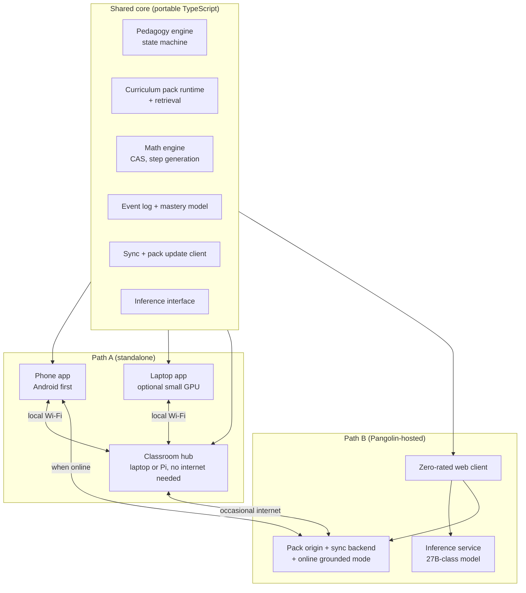
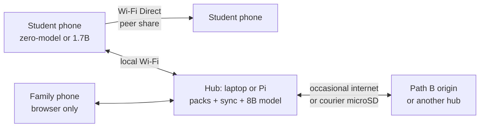
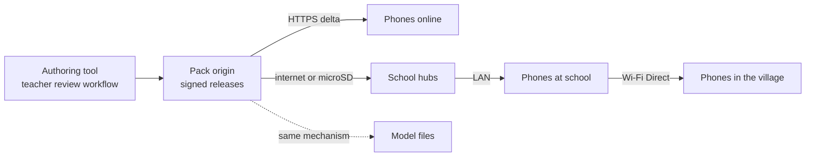

# TAKU-Dzidza Architecture

Version 1.0, 14 July 2026. Companion to [PRD.md](PRD.md). Sources for factual claims: [SOURCES.md](SOURCES.md).

This document separates the two build paths explicitly. **Path A** (sections 3 to 4) is standalone: phones, laptops, and classroom hubs, buildable and shippable with no national or cloud infrastructure. **Path B** (sections 5 to 6) extends the same system onto national sovereign compute. Section 8 states exactly what Path A delivers alone and what Path B adds. Decisions that need a real-device or load test are marked **[GATE]** and specified in section 13.

---

## 1. Shape of the system

One portable core, three deployment tiers, one content format.

The design rule that makes this affordable for a small team: **everything that embodies the product's intelligence lives in the shared core and in the packs.** The pedagogy engine, the pack runtime, the CAS, retrieval, the mastery model, and sync are written once in TypeScript and run unchanged on a phone, a laptop, a hub, a browser, and the Path B server. Shells provide only platform services: an inference binding, SQLite, file and download management, OCR, and local networking. A bug fixed in the hint ladder is fixed everywhere on the next update.

The second rule: **the model is behind an interface and is optional.** `IF` exposes load, generate (streaming), embed, and unload. Implementations: llama.cpp native binding (phone, laptop, hub), server API client (web, or a phone talking to a hub), and a null implementation (zero-model mode). The core never knows or cares which one is present, which is what makes graceful degradation structural rather than hand-coded.

---

## 2. The shared core

### 2.1 Pedagogy engine

A deterministic state machine per problem, as specified in PRD sections 6 and 7. Engineering properties that matter:

- Pure TypeScript, no platform APIs, no direct model calls. It emits *requests* ("phrase hint rung 2 for this student profile") that the shell routes to whatever inference exists, with authored hint text as the always-available fallback.
- The canonical answer and full solution stay in engine-private state. Prompt assembly happens in the engine, so exclusion of the answer from model context is enforced at one choke point, and the post-generation leak filter (string plus CAS-normalized numeric equivalence) sits at the same choke point.
- Fully unit-testable: every gate, rung, fade, and checkpoint rule is a pure function of (problem, student mastery state, session events). The adversarial answer-extraction suite (SafeTutors-style) runs in CI against the engine plus each release model.

### 2.2 Curriculum pack runtime and retrieval

Loads signed packs (format in section 7), resolves the syllabus map, selects problems by mastery and spacing, and serves retrieval queries. Retrieval is hybrid: BM25-style keyword search (SQLite FTS5) plus vector search (sqlite-vec) over pack chunks. Packs ship with **precomputed embeddings**, so a phone only embeds the query (a 300M-class embedding model, or on zero-model devices, FTS5 alone). Every chunk carries grade-band and curriculum tags; the runtime filters by the student's band before anything reaches a model.

### 2.3 Math engine

mathsteps plus nerdamer class libraries (pure JS): symbolic manipulation, equation solving, and, critically, human-readable step sequences. The pedagogy engine uses it to check attempts (is the student's step algebraically valid even if the path differs from the worked solution?), to power step-by-step widget displays, and as the tool the model must call for any computation. SymPy and the Python sidecars are retired everywhere (see section 12).

### 2.4 Event log, mastery model, sync

Append-only event log (xAPI-flavored statements: attempted, hinted at rung n, checkpoint result, explanation graded). The mastery model (per-concept Bayesian Knowledge Tracing to start; simple, inspectable, adequate at this data scale) is a fold over the log, so any two copies of a student's log merge by union and re-fold. That single property makes sync boring: no CRDT library, no conflict UI, just set-union of immutable events plus last-write-wins on a handful of profile fields. Sync targets (hub or Path B backend) are interchangeable.

---

## 3. Path A: device tier

### 3.1 Device classes and what they run

| Device class | Example | Model | What the student experiences |
|---|---|---|---|
| Floor (1 to 2GB RAM) | oldest Androids, Go edition | none (zero-model mode) | Full tutor: packs, ladder with authored text, CAS, widgets, checkpoints, spaced review. No free-form chat |
| Low (3GB) | entry handsets | optional Qwen3 0.6B, Q4, about 0.5GB | Above, plus natural-language phrasing and grounded Q&A, modest quality |
| Default (4GB) | the common $60 to $100 handset | Qwen3 1.7B or Gemma 4 E2B, Q4, 1.1 to 1.5GB | Full experience, usable conversation quality |
| Good (6 to 8GB) | mid-range | Qwen3 4B or Gemma 4 E4B, Q4, 2.4 to 2.7GB | Noticeably better explanation and grading quality |

All candidates are Apache 2.0 (Qwen3 family; Gemma 4 E-series moved to Apache 2.0 in March 2026). Context is held to 2K to 4K tokens on low-RAM devices with quantized KV cache; the pedagogy engine keeps prompts short by design because it sends the current step, not the whole history. Model selection is automatic from detected RAM with a manual override. **[GATE 2]** final model and engine choices come from the bake-off, not this table.

### 3.2 Inference engine

Committed baseline: **llama.cpp**, embedded as a native library (JNI on Android, FFI elsewhere). Reasons: MIT license, GGUF is an open format shared across every tier of this system (phone, laptop, hub, even Path B fallback pools), strongest low-end CPU path (low-end Android is CPU and memory-bandwidth bound; NPUs on cheap handsets are effectively unusable), and no vendor dependency.

Challengers, evaluated in the bake-off behind the same interface: **ExecuTorch** (1.0 GA, production-proven at Meta scale, best NPU breadth if mid-range devices matter more than expected), **LiteRT-LM** (best Gemma-specific path), and **Cactus** (strong published low-end numbers, one SDK across platforms, but its license terms and proprietary model format could not be verified from public sources; it enters only with written license clarity, and the open GGUF path remains the escape hatch regardless). **[GATE 2]**

### 3.3 Storage and app footprint

SQLite everywhere (packs, event log, mastery, settings). App binary target under 40MB via split APKs (arm64-v8a primary). Packs and models are never bundled: first-run offers the smallest useful pack over any channel (download, peer, SD card), and the app is fully functional in zero-model mode from minute one. OCR via ML Kit text recognition (on-device, offline, about 4MB).

### 3.4 Model and pack delivery

The multi-hundred-MB model file is the adoption cliff, so delivery is a designed feature:

- Resumable, sharded HTTPS downloads (range requests, checksum per shard), Wi-Fi-preferred with clear size labels.
- **Peer transfer as a first-class channel:** the app shares itself (APK), packs, and models to nearby devices over Wi-Fi Direct, the same mechanic SHAREit normalized across the region. One student who visits town updates a whole village.
- microSD and file import; kiosk and school preload through hubs.
- App, packs, and models update independently. A UI fix never re-ships a model; pack updates are deltas (section 7).

### 3.5 Laptop tier

Same web-native UI codebase in a thin desktop shell (the existing Tauri investment survives: with the Python sidecars gone, Tauri plus a Rust FFI llama.cpp binding is a clean fit). A CPU-only 8GB laptop runs Qwen3 4B comfortably; a small discrete GPU (GTX 1650 or RTX 3050 class) lifts it to an 8B model at interactive speed. The laptop build doubles as the hub (next section) with one toggle.

---

## 4. Path A: classroom hub

The highest-leverage deployment unit in the system. Hardware: any laptop, mini-PC, or Raspberry Pi at a school, kiosk, or community center, solar-friendly, no internet required.

What hub mode adds on top of the laptop app:

- **Pack origin mirror.** Students' phones discover the hub over local Wi-Fi (mDNS) and pull pack updates and models at LAN speed. The hub itself updates by occasional internet, by courier microSD, or from another hub.
- **Progress aggregation.** Event logs sync to the hub; the teacher dashboard (served by the hub to any browser) shows mastery, effort, and gaming signals per student. When the hub eventually touches the internet, it forwards to the Path B backend if the school opted in.
- **Shared inference.** The hub runs a larger model (8B class on a GPU-equipped laptop; 4B on decent CPU; none on a Pi, which then serves only content and sync) behind an OpenAI-compatible endpoint (llama.cpp server). Phones in range automatically route inference requests to the hub instead of their own small model. Forty students get 8B-quality tutoring from one machine, fully offline.
- **Browser access.** Students without the app, or on family phones, use the hub's web client directly, since the UI is web-native.

Capacity honesty: classroom load is bursty but light. Forty students issuing roughly one 300-token request every 2 to 3 minutes is about 0.3 requests/second. A small-GPU laptop running an 8B model at an aggregate 100 to 300 tokens/second sustains this with queueing headroom; a CPU-only machine will queue noticeably at peak and should default to the 4B model. **[GATE 4]** exact concurrency per hardware class comes from the Phase 0 hub prototype; the design assumes queuing with visible feedback rather than failure.

---

## 5. Path B: the Pangolin-hosted tier

### 5.1 What it is

The same product served from national sovereign compute: a zero-rated web front-end any browser can reach with no install and no data cost, backed by a 27B-class model, the pack origin, the sync backend, and the online grounded mode. The client is the same shared core running in the browser (service-worker cached, packs in OPFS-backed SQLite), so a Path B user's pedagogy is identical to a Path A user's; only the model behind the inference interface is bigger.

That reuse produces the tier's defining resilience property: **when the server is overloaded or unreachable, the web client degrades to Path A behavior in the browser** (cached packs, authored hints, CAS, checkpoints) instead of failing. The national service can brown out gracefully because the product never depended on it for its core.

### 5.2 Infrastructure honesty

ZCHPC's published cluster (about 180 dual-socket x86 nodes, 12 GPU/MIC accelerator nodes, roughly 300 TFLOPS, Inspur, commissioned mid-2010s) is respectable scientific computing but its accelerators predate the LLM era; the design does not assume any of it can serve modern models. **Path B is specified against new GPU procurement under Project Pangolin**, and the sizing below is written so a ministry can read it as a procurement basis. As a stopgap or pilot, the identical stack runs on rented in-region GPUs if data-residency rules permit; nothing in the software cares.

### 5.3 Serving stack and model

- Serving: vLLM or SGLang (both open source; SGLang currently benchmarks ahead at high concurrency) with continuous batching, prefix caching (all students share the tutoring system prompt, a 20 to 30% saving), and FP8 or AWQ quantization.
- Primary model: **Gemma 3 27B (FP8)** or **Qwen3 32B (Apache 2.0)**, chosen by tutoring-quality evals on pack content **[GATE 3]**. Both fit a single modern 80GB GPU quantized. A pool of Qwen3 4B instances provides the degraded-mode and overflow tier.
- Same trust stack as everywhere else, plus server-only additions: a verifier pass on open-ended answers and sampled transcript audits against packs.
- Online grounded mode: server-side retrieval over an allowlisted source set with forced citations, filtered through grade-band controls, cached aggressively (most student queries repeat).

### 5.4 Concurrency, throughput, and cost

The math that matters is request-level, not session-level. A tutoring exchange is a short burst (about 300 output tokens) every 2 to 3 minutes of student thinking, so one GPU serves far more *students* than *simultaneous generations*:

| Quantity | Conservative | Expected | Basis |
|---|---|---|---|
| Aggregate output throughput, 27B FP8, one 80GB GPU | 1,500 tok/s | 3,000 to 5,000 tok/s | batched serving benchmarks; verify on procured hardware [GATE 7] |
| Responses/second per GPU (300-token responses) | 5 | 10 to 16 | above |
| Concurrently active students per GPU (1 request per 150s each) | 750 | 1,500 to 2,500 | above |
| Active students on an 8-GPU cluster | 6,000 | 12,000 to 20,000 | linear, minus overhead |
| Registered students supportable (peak-hour concurrency near 10 to 15%) | about 50,000 | 100,000+ | usage-pattern assumption, validate in pilot |

Cost per delivered tutoring: at rented-GPU proxy prices (roughly $2/hour per 80GB GPU), serving costs land in the range of $0.20 to $0.60 per million output tokens. A full student-hour of tutoring (20 to 30 exchanges) consumes under 10,000 output tokens, so **well under one US cent per student-hour**. An 8-GPU deployment is roughly $300,000 to $500,000 of capex (or about $140,000/year rented) to serve a six-figure student population. These are the numbers that make Path B a credible national program rather than a demo.

### 5.5 Behavior under load

Ordered degradation, all automatic, all visible to the student in plain language:

1. Prefix-cache and batch harder; response latency stretches first.
2. Per-student token budgets tighten (shorter phrasing, same pedagogy).
3. Overflow requests route to the 4B pool (quality dips, nothing breaks).
4. Queue with honest position feedback for open-ended chat only; ladder phrasing falls back to authored text instantly.
5. Full brown-out: the web client continues in client-side Path A mode.

### 5.6 Zero-rating and privacy

Zero-rating is contractual plus technical: reverse billing with each telco and domain allowlisting at their gateways, the mechanism proven locally by Econet Zero and regionally by Moya/biNu. The front-end is engineered for it: a compact origin set, aggressive caching, no third-party domains. Student data stays in-country; the backend holds event summaries and mastery states, not transcripts by default, under the consent and licensing regime in PRD section 15.

---

## 6. What Path A gives alone, and what Path B adds

| Capability | Path A alone | Path B adds |
|---|---|---|
| Full tutor offline (packs, ladder, CAS, widgets, checkpoints) | Yes, on any phone including zero-model | Nothing; identical core |
| Natural-language tutoring | Small model on capable phones; 8B via hub | 27B-class quality for any connected browser, no install |
| Reach | Requires app or hub access | Any browser, zero-rated, including shared and family devices |
| Knowledge freshness | Delta packs via download, hub, peer, microSD | Origin service, faster propagation, online grounded mode for current information |
| Teacher visibility | Per-school via hub dashboard | National and district dashboards, opt-in |
| Measurement | On-device and per-hub analytics | Fleet-level honest-learning metrics, evaluation-study backbone |
| Sovereignty story | Data never leaves the device or school | National deployment on Pangolin, flagship workload |
| Dependencies | None outside the team | GPU procurement, telco agreements, ops capability |

Path A is the mission and is complete on its own. Path B multiplies quality for connected students, adds the no-install reach that zero-rating buys, and turns the product into national infrastructure. Build order follows dependency order: A, then B on top of it.

---

## 7. Curriculum pack format and distribution

A pack is a content-addressed bundle: a signed manifest (Ed25519) listing zstd-compressed chunks by hash, plus SQLite-ready payloads: syllabus map, problems (statement, canonical answer, tiered hints, worked solution, concept and grade tags, difficulty), lesson widget definitions, retrieval corpus with precomputed embeddings, and language variants.

- **Deltas by construction:** an update ships only chunks whose hashes changed, typically a few MB against a multi-hundred-MB pack.
- **Any transport:** HTTPS from the origin, hub LAN, Wi-Fi Direct peer transfer, or a file on a microSD card. Because verification is signature-based, the transport is irrelevant to trust; a pack that arrives by donkey is as authentic as one from the server.
- **Versioned and dated:** the client shows content age where currency matters, and packs declare a review cadence so stale-content warnings are principled.
- Models are distributed through the same signed-manifest mechanism (sharded, resumable), just with engine-specific payloads instead of SQLite payloads.

---

## 8. Security and privacy engineering

- All content and models signed; the app pins the release public key. Sneakernet is safe because trust is cryptographic, not transport-based.
- Local-first student data; sync payloads are event summaries and mastery states, TLS in transit, minimal by design. Guardian-consent flow gates any off-device sync (Cyber and Data Protection Act; under-18 consent; POTRAZ data-controller licensing per SI 155 of 2024).
- Hubs hold class data: encrypted at rest, school-owned, with a documented retention and deletion policy; the teacher dashboard shows effort and mastery, not conversation transcripts.
- No secrets in the client. Path B API access is session-token based; abuse controls (rate limits per student, per school) protect the free tier.
- Prompt-injection posture: the pedagogy engine, not the model, holds all authority; pack content is the only material injected into prompts, and packs are signed and human-reviewed. The leak filter and adversarial suite (SafeTutors-style) run per release.

---

## 9. The app shell decision [GATE 1]

The UI is web-native either way (the lesson widgets are Canvas/SVG, and Path B needs a browser client regardless). The open question is the mobile wrapper.

**Recommendation: Capacitor wrapping the existing SolidJS codebase.** One UI codebase then serves the Android app, the laptop shell, the hub's browser client, and the Path B web front-end; the team already builds in SolidJS (the v2 frontend); and Solid's small runtime is a genuine asset on weak WebViews. Native plugins carry the heavy parts: llama.cpp inference, SQLite, downloads, Wi-Fi Direct, ML Kit.

**The honest risk:** WebView performance and version spread on the oldest Android handsets, and a thinner on-device-LLM plugin ecosystem than React Native's (where ExecuTorch, llama.rn, and Cactus all ship maintained bindings). If the Phase 0 test shows the widget runtime cannot hold interactive frame rates on a 2GB device, or the inference plugin work is deeper than budgeted, the fallback is **React Native plus Expo with the same shared TS core**, at the cost of a separate web build. The shared core makes this a shell swap, not a rewrite, which is precisely why the core comes first in the build order.

This differs from the earlier plan, which had settled on React Native. The settled part that survives: the portable TypeScript core. The shell is demoted to a gated, replaceable decision.

---

## 10. Model strategy summary

| Tier | Model (primary / alternate) | License | Role |
|---|---|---|---|
| Phone floor | none | n/a | zero-model mode |
| Phone 3GB | Qwen3 0.6B | Apache 2.0 | phrasing, light Q&A |
| Phone 4GB (default) | Qwen3 1.7B / Gemma 4 E2B | Apache 2.0 | full conversational layer |
| Phone 6 to 8GB | Qwen3 4B / Gemma 4 E4B | Apache 2.0 | better grading and explanation |
| Laptop / hub CPU | Qwen3 4B | Apache 2.0 | shared or personal |
| Hub or laptop small GPU | Qwen3 8B class | Apache 2.0 | classroom-grade tutoring |
| Path B primary | Gemma 3 27B FP8 / Qwen3 32B | Gemma terms / Apache 2.0 | hosted tier |
| Embeddings | 300M-class (EmbeddingGemma / MiniLM family) | permissive | retrieval queries |
| Math booster (optional, routed) | Phi-4-mini-reasoning / R1-Distill-Qwen-1.5B | MIT | hard maths on capable devices |

Fine-tuning program, in order of leverage:

1. **Tutoring distillation:** a large teacher model generates Socratic tutoring dialogues over pack content (attempt, rung phrasing, misconception feedback); human-reviewed; SFT onto the small models. This is the proven recipe behind LearnLM-class quality and the single biggest quality lever available to small models.
2. **DPO answer-withholding:** preference pairs of withhold-versus-reveal, so the model's default matches what the code enforces anyway.
3. **Readability control:** grade-band-conditioned examples in the same SFT mix (ReadCtrl-style).
4. **Language adapters:** Shona LoRA when data and quality reviews permit; Ndebele as a data-collection track. Adapters are tens of MB and distribute like packs.

---

## 11. Data model and sync summary

- SQLite on every platform (native driver on device and hub; OPFS-backed in browsers).
- Immutable event log; mastery is a deterministic fold; merge is set-union plus re-fold, so device-to-hub-to-origin sync needs no conflict resolution machinery.
- Sync is opportunistic and prioritized: mastery summaries first (bytes), event batches second, content pulls last. Everything survives interruption and resumes.

---

## 12. Migration from v2

What survives: the SolidJS frontend investment (becomes the universal UI layer), the Tauri desktop shell (llama.cpp moves from Python sidecar to Rust FFI), lessons learned in the inference protocol, and the brand and chat UX work.

What retires: all five Python sidecars. `llm_inference.py` is replaced by native llama.cpp bindings behind the inference interface; `solve_math.py` (SymPy) by the JS CAS in the shared core; `route_query.py` by the pedagogy engine, which makes routing decisions deterministically; `ocr_image.py` by ML Kit; `save_session.py` by the SQLite event log. This is forced, not stylistic: Tauri v2 sidecars are desktop-only and iOS forbids spawned executables, so the sidecar architecture physically cannot reach the target devices.

Build order: shared core first (it can be developed and tested inside the current desktop shell against real content), then the Android shell, then hub mode, then Path B.

---

## 13. Decision gates and test specifications

| # | Decision | Test | Pass criteria |
|---|---|---|---|
| 1 | App shell (Capacitor vs RN) | Widget runtime demo (interactive graph, drag manipulatives, animated feedback) on a 2GB and a 4GB Android in WebView; inference-plugin spike | Steady interaction at target frame rate on the 4GB device, acceptable on 2GB fallback rendering; plugin spike lands streaming tokens in under a week of effort |
| 2 | Inference engine and default model | Bake-off: llama.cpp, ExecuTorch, LiteRT-LM, (Cactus if licensed) running Qwen3 1.7B and Gemma 4 E2B on the same handsets | Best sustained tok/s within RAM and thermal limits over a 20-minute session; cold start under 10s; battery drain per session measured and acceptable |
| 3 | Path B model | Blind tutoring-quality eval (rubric: correctness on pack content, rung discipline under attack, level match) Gemma 3 27B vs Qwen3 32B | Higher rubric score wins; license terms acceptable to ministry |
| 4 | Hub capacity | llama.cpp server on Pi 5, CPU laptop, small-GPU laptop; simulated classroom (40 students, Poisson requests) | Queue P95 latency under a set threshold per hardware class; publish the resulting hardware guidance |
| 5 | Effort-gate strictness | Pilot A/B on gate variants | Retention and unaided-checkpoint deltas |
| 6 | Small-model self-explanation grading | 500 labeled student explanations vs model grades | Agreement threshold vs keyword-baseline; below it, ship the fallback grader |
| 7 | Path B real throughput | Load test on procured or rented target GPUs before launch commitment | Measured students-per-GPU within the ranges in section 5.4 |
