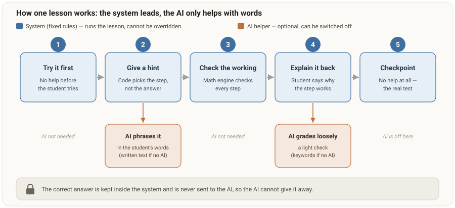
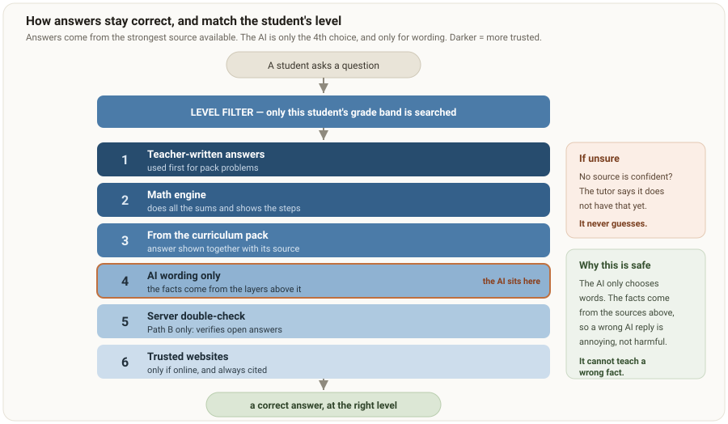
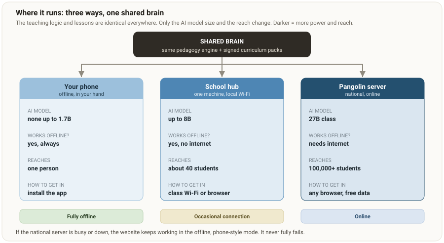
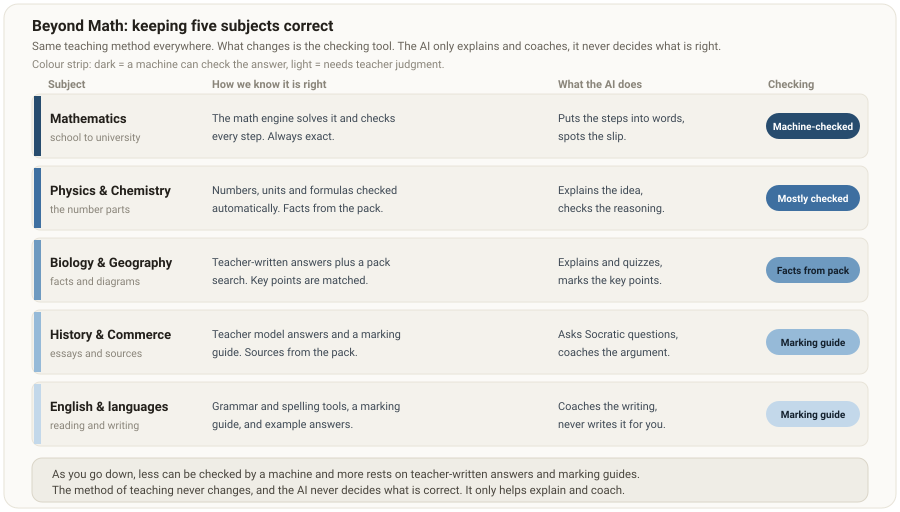
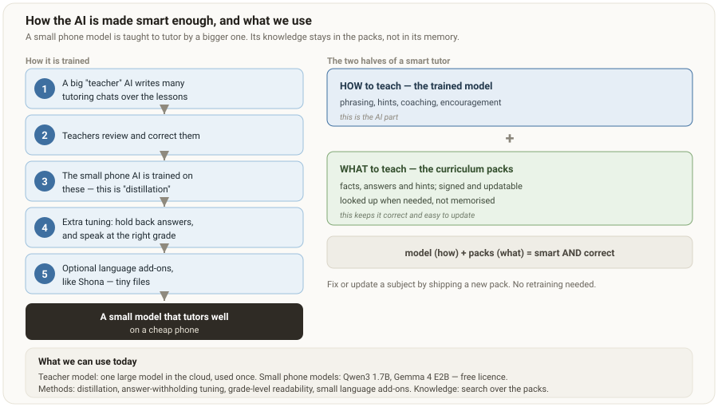

# TAKU-Dzidza: Visual Overview

Plain-language pictures of how the product works. Each diagram is saved in `docs/diagrams/`. The words under each picture describe it fully, so the meaning is clear even without opening the image. This document is a companion to `PRD.md` and `ARCHITECTURE.md`.

## 1. How one lesson works

The lesson is run by fixed rules in the code, shown in blue. The student has to try first, then gets hints one step at a time, the working is checked by the math engine, the student explains the step in their own words, and there is a checkpoint with no help at all. The AI, shown in orange, only puts hints into friendly words and gives a light check on explanations, and it can be switched off. The correct answer is held by the system and never sent to the AI, so the AI cannot give it away.

## 2. How answers stay correct and at the right level

A question is first limited to the student's own grade band, so a young learner never gets a university answer. Answers then come from the strongest source available, in order: teacher-written answers, the math engine, the curriculum pack, then AI wording only, then a server double-check on the hosted version, then trusted websites when online. If no source is confident, the tutor says it does not have that yet. It never guesses. Because the facts come from the sources above the AI, a wrong AI reply can be annoying but cannot teach a wrong fact.

## 3. Where it runs

The same brain runs three ways. On a phone it works fully offline with a small model or none at all. A single cheap machine at a school, called the hub, serves a whole class over local Wi-Fi with a larger model and needs no internet. The national Pangolin server gives the best quality to any browser for free through zero-rating. If the server is ever busy or down, the website falls back to the offline phone experience, so it never fully fails.

## 4. Keeping five subjects correct

The teaching method is the same for every subject. What changes is how an answer is checked. Math is checked exactly by the math engine. Sciences have their numbers and units checked automatically, with facts from the pack. Biology and geography use teacher-written answers and a search of the pack. History and English use teacher model answers and marking guides, because there is no single right answer. The further down the list, the less a machine can check and the more it rests on teacher-written material. The AI never decides what is correct. It only explains and coaches.

## 5. How the AI is made smart enough

A big teacher AI writes many tutoring conversations over the lessons, teachers review and correct them, and the small phone model is trained on them. This is called distillation. It is then tuned to hold back answers and to speak at the right grade level, with optional language add-ons such as Shona as tiny extra files. The model is the how-to-teach half. The curriculum packs are the what-to-teach half, looked up when needed rather than memorised. That split is what keeps the tutor correct and easy to update: to fix or refresh a subject, we ship a new pack, with no retraining.

## What we can use today

Small phone models such as Qwen3 1.7B or Gemma 4 E2B under free licences. A larger teacher model, used once in the cloud, to train them. Methods including distillation, answer-withholding tuning, grade-level readability, and small language add-ons. Knowledge comes from search over the signed curriculum packs. Full detail and sources are in `ARCHITECTURE.md` and `SOURCES.md`.
